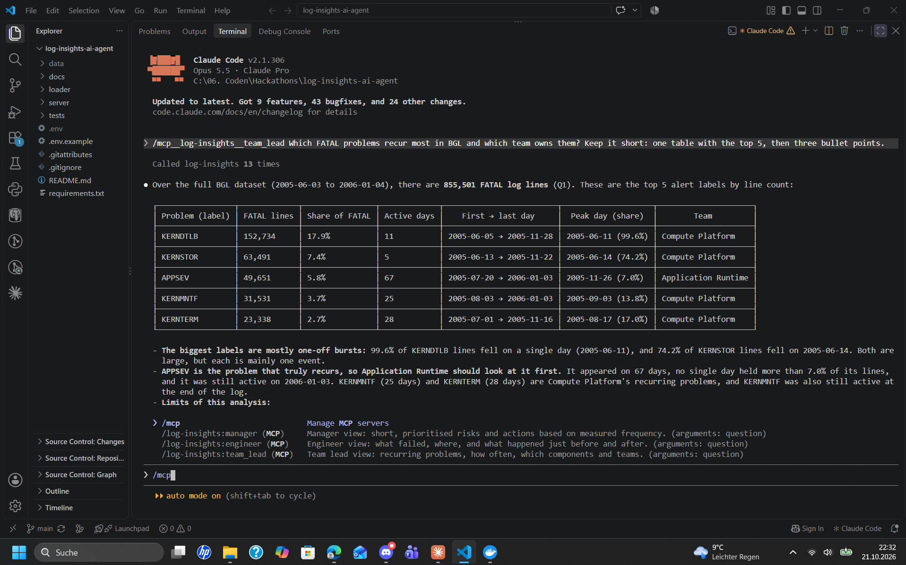

# Hackathon Project: Log Insights AI Agent

This project was developed at the **National AI Hackathon 2026** (SchubKI) in a team of two students for the SereneDB challenge *"Making Sense of Logs – The Right Insights for the Right People"*.  
It is an AI agent that answers questions about millions of system log lines and adapts the answer to the person asking: an **engineer**, a **team lead** or a **manager**. The agent (Claude in Claude Code) does not read raw log files. Instead, it calls the tools of our own **MCP server**, which run SQL queries in **SereneDB**, so every number in an answer comes from a real query.

**The database searches and calculates; the agent explains.**


---

## Screenshot of the Agent

Team lead question in Claude Code: the agent calls the MCP tools and answers with measured numbers from SereneDB.

<p align="center">
  
</p>


---

## Table of Contents

This README provides an overview of the project, describes the technologies used and my individual contributions, explains how to set up and run the agent locally, and lists the tools, results and known limitations.

1. [Project overview](#project-overview)
2. [Tech stack](#tech-stack)
3. [My contributions](#my-contributions)
4. [Requirements to run the project](#requirements-to-run-the-project)
5. [How to run the project](#how-to-run-the-project)
6. [How to use the agent](#how-to-use-the-agent)
7. [Tools](#tools)
8. [Results (worked investigation)](#results-worked-investigation)
9. [Known limitations](#known-limitations)
10. [Dataset attribution](#dataset-attribution)


---

## Project Overview

The same logs matter differently to different people. An engineer needs the failing lines and what happened just before. A team lead needs to know which problems keep coming back and who owns them. A manager needs a short, prioritised list. All three need numbers they can trust.

The project works on two public research log collections from [Loghub](https://github.com/logpai/loghub), imported completely:

- **BGL** – BlueGene/L supercomputer logs, 4,747,963 lines (2005–2006)
- **OpenStack** – OpenStack Nova cloud logs, 207,820 lines (2017)

```text
Question ──► Claude Code ──► MCP server (server/server.py) ──► SereneDB (SQL, full-text index)
   ▲                              │  tools + evidence record          │
   └──── role-specific answer ◄───┴──────────── rows, counts ◄────────┘
```


### Key Features:

**1) Complete data, validated**
- Python loader imports the full BGL and OpenStack datasets, checks them with 54 SQL validations and builds full-text indexes

**2) Search and analytics in one database**
- Full-text search on SereneDB's inverted index with BM25 ranking, optionally as phrase search
- Exact counts and time trends over all rows with SQL aggregations

**3) Six read-only MCP tools instead of free SQL**
- `describe_dataset`, `search_logs`, `nearby_events`, `count_by`, `trend`, `ping`
- All inputs are passed as SQL parameters, columns and time buckets come from fixed whitelists

**4) Evidence for every number**
- Each tool result carries a query id, the SQL, the parameters, the data scope, row counts and a truncation flag

**5) Three roles, one agent**
- Engineer, team lead and manager use the same tools and data, but each role prompt collects different evidence and gives a different kind of recommendation
- Answers separate *observed facts*, *hypotheses*, *unknowns* and *recommendations*


### Project Process

We first agreed on a shared data and tool contract ([docs/schema.md](docs/schema.md)) and then worked in parallel: **loader and data validation** on one side, **MCP server, tools and role prompts** on the other.  
Every change was tested on **Windows and Linux** against the complete data, and role answers were checked against the tool results. Where the model computed numbers itself and got them wrong, we moved the calculation into the database.  
We used AI coding assistants (Claude Code and Codex) throughout the hackathon.

- Presentation slides: click [here](docs/slides.pdf)


---

## Tech stack

**Language**

- **Python** (3.12 or newer)

**Database**

- **SereneDB** (search and analytics database with PostgreSQL wire protocol, running in **Docker**)
- Inverted full-text index with **BM25** ranking

**Agent**

- **Claude Code** with Claude Sonnet 5.5 / Opus 5.5
- **MCP** (Model Context Protocol) server built with the official Python SDK

**Python packages**

- `mcp[cli]` (MCP server framework)
- `psycopg[binary]` (database driver for SereneDB)
- `python-dotenv` (connection settings from `.env`)


---

## My contributions

### MCP server and tools
- Set up the MCP server and implemented the core tools `search_logs`, `nearby_events`, `count_by`, `trend` and `ping`
- Implemented full-text search on the inverted index with BM25 ranking and deterministic result ordering
- Implemented `nearby_events` centred on an anchor line (per node for BGL, per file for OpenStack)
- Added the alert-label filter for BGL and fixed the truncation flag for groups with missing values

### Evidence record and trend statistics
- Designed the evidence record that every tool returns (query id, SQL, parameters, scope, counts, truncation, status)
- Moved trend statistics (active days, first/last day, peak and peak share) into the database, so the model no longer computes them itself

### Role prompts
- Wrote the shared evidence rules and the engineer, team lead and manager prompts
- Gave the manager a fixed candidate set and ranking rule, so repeated answers stay comparable

### Documentation and testing (together with Berkan)
- Data and tool contract, clean-checkout tests on Windows and Linux, worked investigation, README

My teammate **Berkan Gürbüz** built the data loader, the data validation and the database schema.


---

## Requirements to run the project

To run the project locally you need to install the following tools:

- **Python 3.12 or newer** ([Download](https://www.python.org/downloads/))
- **Docker Desktop** ([Download](https://docs.docker.com/get-docker/))
- **Claude Code** ([Setup guide](https://code.claude.com/docs/en/setup)) with a paid Claude plan or a Console account

All Python dependencies are defined in `requirements.txt`. The datasets are downloaded in step 3 (about 60 MB, BGL unpacks to about 740 MB).


---

## How to run the project

All commands are run from the repository root. Where Windows differs, the PowerShell command is shown below the Linux/macOS one.

### 1) Clone the repository

```bash
git clone https://github.com/celil-durna/log-insights-ai-agent.git
cd log-insights-ai-agent
```

### 2) Install dependencies and create `.env`

```bash
python3 -m venv .venv
source .venv/bin/activate
python -m pip install -r requirements.txt
cp .env.example .env
```

Windows (PowerShell):
```powershell
python -m pip install -r requirements.txt
Copy-Item .env.example .env
```

`.env` holds the database connection. The defaults match the Docker container from step 4.

### 3) Download the datasets

```bash
mkdir -p data/full/BGL data/full/OpenStack
curl -L -o data/full/BGL.zip "https://zenodo.org/records/8196385/files/BGL.zip?download=1"
unzip data/full/BGL.zip -d data/full/BGL
curl -L -o data/full/OpenStack.tar.gz "https://zenodo.org/records/8196385/files/OpenStack.tar.gz?download=1"
tar -xzf data/full/OpenStack.tar.gz -C data/full/OpenStack
```

Windows (PowerShell):
```powershell
New-Item -ItemType Directory -Force data\full\BGL, data\full\OpenStack | Out-Null
curl.exe -L -o data\full\BGL.zip "https://zenodo.org/records/8196385/files/BGL.zip?download=1"
Expand-Archive data\full\BGL.zip -DestinationPath data\full\BGL
curl.exe -L -o data\full\OpenStack.tar.gz "https://zenodo.org/records/8196385/files/OpenStack.tar.gz?download=1"
tar -xzf data\full\OpenStack.tar.gz -C data\full\OpenStack
```

### 4) Start SereneDB (Docker)

Make sure **Docker Desktop** is running, then run:

```bash
docker run -d --name serenedb -p 127.0.0.1:7890:7890 -e POSTGRES_PASSWORD=hackathon -v serenedb-data:/var/lib/serenedb -v "$PWD/data":/data serenedb/serenedb:latest
```

Windows (PowerShell):
```powershell
docker run -d --name serenedb -p 127.0.0.1:7890:7890 -e POSTGRES_PASSWORD=hackathon -v serenedb-data:/var/lib/serenedb -v "${PWD}\data:/data" serenedb/serenedb:latest
```

Later starts: `docker start serenedb`.

### 5) Import and validate the data

```bash
python -m loader.db
python -m loader.load
```

The first command checks the connection and prints `(1,)`. The second imports and validates both datasets and builds the search indexes (about 2 minutes). It ends with `Success: 54 SQL checks passed.`

### 6) Install Claude Code and register the MCP server

If Claude Code is not installed yet:

```bash
curl -fsSL https://claude.ai/install.sh | bash
```

Windows (PowerShell):
```powershell
irm https://claude.ai/install.ps1 | iex
```

Then register the MCP server once:

```bash
claude mcp add log-insights -- "$PWD/.venv/bin/python" "$PWD/server/server.py"
```

Windows (PowerShell):
```powershell
claude mcp add log-insights -- python "$PWD\server\server.py"
```

### 7) Start the agent

Start `claude` in the repository folder and type `/mcp`: `log-insights` should be connected with **6 tools**.

### 8) How to stop everything

- Leave Claude Code with `/exit`
- Stop the database container (data stay in the volume):
  ```bash
  docker stop serenedb
  ```


---

## How to use the agent

Choose a role prompt and type the question after it:

```text
/mcp__log-insights__engineer In BGL, investigate the APPREAD alerts on 2005-06-16. What failed and what happened just before and after the first one?
/mcp__log-insights__team_lead Across the full BGL dataset, which FATAL problems recur, how often, and which teams should investigate first?
/mcp__log-insights__manager Across BGL and OpenStack, which observed problems deserve attention first and what should happen next?
```

Add `Include the exact SQL of every query in the evidence list.` to see the SQL behind each number.


---

## Tools

| Tool | Purpose | Main inputs |
| --- | --- | --- |
| `describe_dataset` | Size, time range and valid filter values of a dataset | `dataset` |
| `search_logs` | Full-text search (BM25), optional phrase search | `text`, filters, `from_ts`/`to_ts`, `limit` |
| `nearby_events` | Lines just before and after an anchor line | `line_no` or `ts`, `window_seconds`, `node`/`request_id` |
| `count_by` | Exact counts per group over all filtered rows | `group_by`, filters, `limit` |
| `trend` | Counts per minute/hour/day plus active days and peak share | `bucket`, filters |
| `ping` | Connection check | – |

All tools are read-only. Full input and output contract: [docs/schema.md](docs/schema.md).


---

## Results (worked investigation)

[docs/worked_investigation.md](docs/worked_investigation.md) shows one complete investigation with all tool calls, SQL and results, from the whole corpus down to a single minute:

- **Manager:** APPSEV and KERNMNTF are the recurring BGL problems to assign first; KERNDTLB and KERNSTOR were single bursts in June 2005.
- **Team lead:** 855,501 of 4.7 million BGL lines are FATAL; among the five largest labelled problems, APPSEV is the most persistent (67 active days).
- **Engineer:** on 2005-06-16, 2,040 APPREAD errors from 510 nodes appeared between 14:50 and 15:03, immediately after two failed job logins (`chdir … No such file or directory`). The link is a hypothesis, not proven.


---

## Known limitations

- Counts are log lines, not incidents. One event can write one line per node.
- The team ownership mapping is fictional; cost, downtime and customer impact are never estimated.
- OpenStack covers only three days, so its recurrence cannot be assessed.
- The wording of answers can vary between runs; the numbers come from the database and are reproducible.
- SereneDB occasionally crashed during our tests (exit code 139). If a tool returns a connection error, run `docker start serenedb` and restart Claude Code.
- Not implemented (optional in the challenge): agent-managed indexes, very large remote datasets, traces and metrics.


---

## Dataset attribution

Loghub: Zhu et al., *Loghub: A Large Collection of System Log Datasets for AI-driven Log Analytics*, ISSRE 2023. BGL: Oliner & Stearley, *What Supercomputers Say*, DSN 2007. See the [Loghub repository](https://github.com/logpai/loghub) for usage terms.
